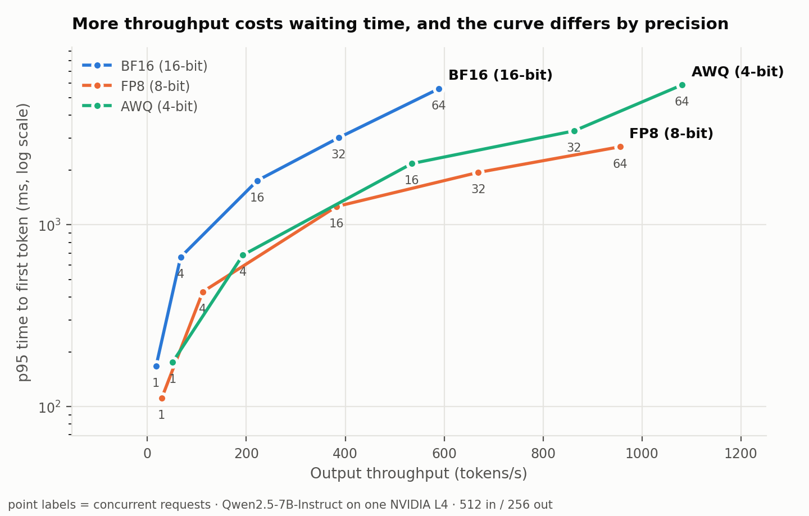
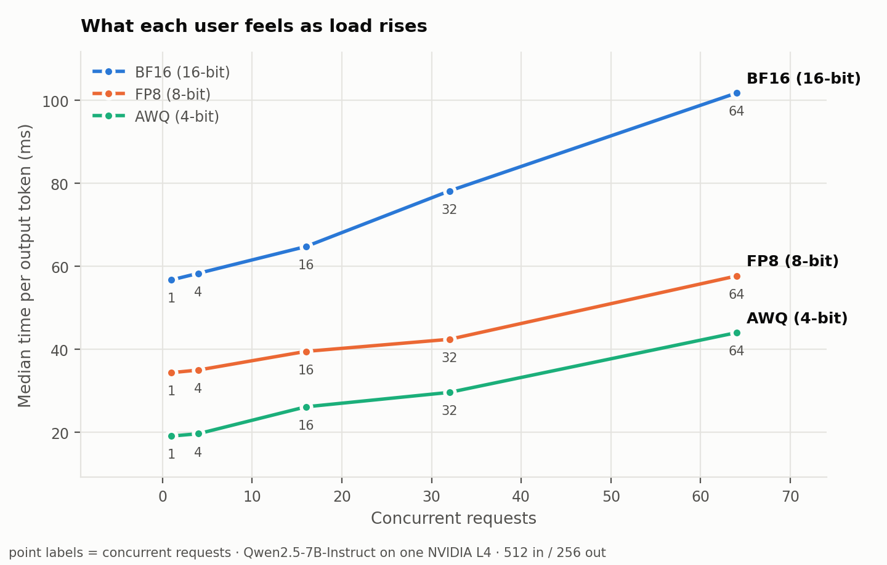

# vLLM serving benchmark: precision vs latency, throughput, cost and accuracy

On one NVIDIA L4, serving Qwen2.5-7B in 4-bit AWQ moved 1.8x more tokens per second than BF16 at 64
concurrent requests, and FP8 cut p95 time to first token roughly in half, neither of them at any
measurable cost in accuracy (90.9% / 90.3% / 90.5% on the full GSM8K test set, paired p = 0.38 and 0.66).

No setup wins everywhere, so the choice depends on the latency target. FP8 is the one to use for chat,
where what users feel is the wait before the first word: at 64 concurrent requests its p95 time to first
token is 2.7 s against 5.6 s for BF16 and 5.9 s for AWQ. AWQ is the one to use for batch work, where
total tokens per hour is what matters, at 1,081 tokens/s and $0.21 per 1M output tokens. BF16 is
dominated, since FP8 beats it on every metric at every load level measured here.

<picture>
  <source media="(prefers-color-scheme: dark)" srcset="analysis/figures/tradeoff-dark.png">
  
</picture>

Model: Qwen2.5-7B-Instruct. GPU: NVIDIA L4 (23 GB, Colab). Server: vLLM 0.29.0, PyTorch 2.13 / CUDA 13.0.

## Comparisons

| Label | Weights | Math runs at | How it is made |
|---|---|---|---|
| `bf16` | 16-bit float | 16-bit | as published |
| `fp8` | 8-bit float | 8-bit, on the L4's FP8 hardware | converted at load: `--quantization fp8` |
| `awq` | 4-bit integer, group size 128 | 16-bit, converted on the fly | pre-quantized checkpoint `Qwen2.5-7B-Instruct-AWQ` |

Generating tokens is limited by memory bandwidth, since every step reads the whole model, while
processing the prompt is limited by compute. That split explains most of what follows: AWQ reads a
quarter of the bytes and so generates fastest, and FP8 is the only one that makes the arithmetic itself
cheaper, which is why it is the only one that improves time to first token.

### Throughput and latency

512 input tokens, 256 output tokens per request, `vllm bench serve` with the random dataset.

| Concurrent requests | BF16 tok/s | FP8 tok/s | AWQ tok/s | BF16 p95 TTFT | FP8 p95 TTFT | AWQ p95 TTFT |
|---|---|---|---|---|---|---|
| 1 | 17.5 | 28.9 | 50.8 | 167 ms | 111 ms | 175 ms |
| 4 | 67.2 | 112.0 | 193.0 | 664 ms | 428 ms | 681 ms |
| 16 | 222.4 | 382.5 | 534.9 | 1,753 ms | 1,261 ms | 2,174 ms |
| 32 | 386.9 | 668.8 | 862.8 | 3,014 ms | 1,942 ms | 3,287 ms |
| 64 | 589.3 | 955.8 | 1,080.9 | 5,607 ms | 2,688 ms | 5,882 ms |

AWQ's advantage over BF16 shrinks as load rises, 2.90x at one request and 1.83x at 64, because the GPU
moves from memory-limited to compute-limited and 4-bit weights stop paying off.

<picture>
  <source media="(prefers-color-scheme: dark)" srcset="analysis/figures/peruser-dark.png">
  
</picture>

### Cost per 1M output tokens

Computed as GPU $/hour divided by tokens per hour, at $0.80 per L4-hour, which is Modal's published
per-second rate ($0.000222/s) read on 19 Sep 2026. It is a list price, not a bill.

| Concurrent requests | BF16 | FP8 | AWQ |
|---|---|---|---|
| 1 | $12.70 | $7.70 | $4.38 |
| 4 | $3.31 | $1.98 | $1.15 |
| 16 | $1.00 | $0.58 | $0.42 |
| 32 | $0.57 | $0.33 | $0.26 |
| 64 | $0.38 | $0.23 | $0.21 |

### Accuracy

GSM8K, all 1,319 test questions, temperature 0, answers parsed out of the reply and compared as numbers.
Every setup answered the same questions, so the comparison is paired and uses an exact McNemar test on
the questions where two setups disagree.

| Setup | Correct | Accuracy | 95% CI | vs BF16 |
|---|---|---|---|---|
| BF16 | 1199 / 1319 | 90.9% | 89.2 to 92.3% | |
| FP8 | 1191 / 1319 | 90.3% | 88.6 to 91.8% | 36 vs 28 discordant, p = 0.382 |
| AWQ | 1194 / 1319 | 90.5% | 88.8 to 92.0% | 43 vs 38 discordant, p = 0.657 |

The same eval workload also finishes faster on the quantized servers: 1,259 s on BF16, 769 s on FP8 and
467 s on AWQ.

## Limits

One GPU, one model, one prompt shape (512 in / 256 out), and all three of those move the numbers. With
1,319 paired questions the test can rule out accuracy gaps of roughly 2 points but not smaller ones, so
"no measurable difference" is not the same as "no difference", and GSM8K is arithmetic reasoning, so a
harder task may separate these setups where this one does not. Colab also gives no control over which
physical L4 you get, and the runs here were taken across several sessions. The FP8 numbers are weight and
activation quantization applied at load time, not a calibrated offline checkpoint.

## Reproduce

```bash
# 1. serve one precision (separate server per config)
vllm serve Qwen/Qwen2.5-7B-Instruct --quantization fp8 --max-model-len 4096 --gpu-memory-utilization 0.90

# 2. sweep concurrency; writes results/raw/fp8_c*.json
python bench/sweep.py --config configs/fp8.yaml

# 3. accuracy on the same questions for every config
python eval/eval_acc.py --label fp8_full --n 1319
python eval/eval_acc.py --compare bf16_full fp8_full

# 4. rebuild every table and chart from the raw files
python analysis/report.py
```

`bench/sweep.py` asks the server which model it is serving and refuses to run when that does not match
the config, which is how a mislabelled run gets caught before it is saved.

## Layout

```
bench/sweep.py          concurrency sweep driven by a config file
eval/eval_acc.py        GSM8K accuracy and paired exact-McNemar comparison
configs/                one file per serving setup
results/raw/            every run, committed, never edited by hand
analysis/report.py      rebuilds all tables and figures from results/raw
analysis/figures/       committed PNGs, light and dark
```
